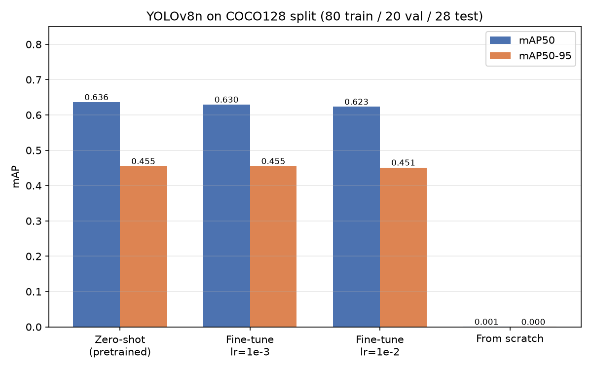
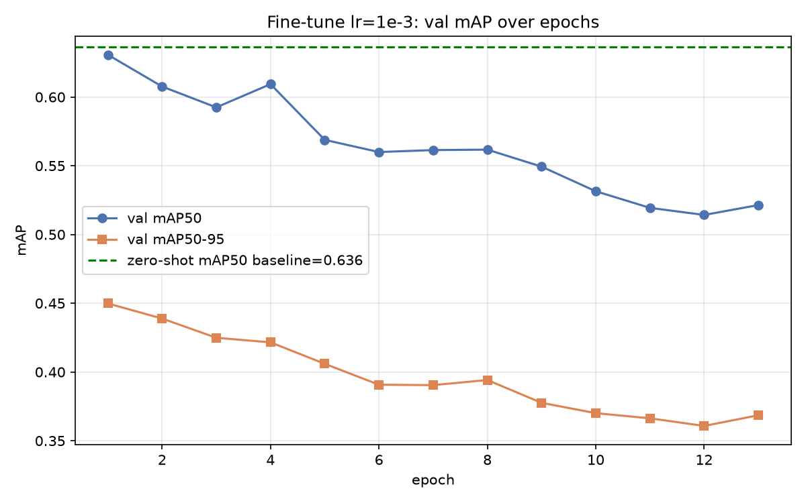

# YOLOv8n 目标检测：零样本 vs 微调 vs 从头训练

在同一数据集、同一模型、同一优化策略下，用**三臂对照实验**量化预训练权重在目标检测任务上的价值，并揭示小数据检测任务的学习规律。

## 核心结果（28 张留出测试集，mAP）

| 实验臂 | mAP50 | mAP50-95 | Precision | Recall |
|--------|-------|----------|-----------|--------|
| **零样本（官方预训练）** | **0.6365** | 0.4552 | 0.7066 | 0.5450 |
| 微调 lr=1e-3 | 0.6296 | 0.4554 | 0.7654 | 0.5151 |
| 从头训练 | 0.0006 | 0.0002 | 0.0011 | 0.0120 |

## 关键发现

1. **零样本已经很强**：官方预训练 YOLOv8n 没看 COCO128 一眼，就在留出测试集上拿到 mAP50 0.636——预训练特征已含大量通用检测知识。
2. **微调没有提升**：lr=1e-3 得 0.630，在零样本基线的噪声带内（-0.7pp）。80 张图对检测来说等于没有数据，预训练权重是唯一信号。
3. **从头训练彻底失败**：mAP50 0.0006，80 张图学 80 类几乎不可能，揭示检测任务的数据需求远高于分类。
4. **方法论收获**：官方 `coco128.yaml` 会把 train 混进 val（数据泄漏），本仓库用 seed 42 切出**三段零重叠**的 80/20/28 划分，保证结论可信。

## 与第一步的对照

| | 第一步：图像分类 | 第二步：目标检测 |
|------|----------------|----------------|
| 数据集 | CIFAR-10（50k 训练） | COCO128（80 训练） |
| 从头训练 | 71.48% | mAP50 0.0006 |
| 微调 | 82.04%（+10.56pp） | 0.6296（-0.7pp，噪声内） |
| 结论 | 数据够，微调有效 | 数据太少，预训练是唯一信号 |

**数据规模决定论**：检测比分类需要多几个量级的数据。这是本实验最有价值的一课。

## 目录结构

~~~
yolov8n-coco128-detection/
├── README.md                本文件
├── requirements.txt         依赖
├── download_data.py         自动下载数据集+权重
├── code/
│   ├── detect_coco128.py    主脚本（prepare/baseline/finetune/scratch/evaluate）
│   └── plot_detect.py       可视化
├── figures/                 实验产出图
├── results/
│   └── result_summary.json  三臂完整指标
└── data/                    数据集（不入库，见 .gitignore）
~~~

## 快速开始

~~~bash
pip install -r requirements.txt
python download_data.py

# 1) 切分数据集（修复官方泄漏：80 train / 20 val / 28 test）
python code/detect_coco128.py prepare

# 2) 零样本基线
python code/detect_coco128.py baseline

# 3) 微调（lr=1e-3）
python code/detect_coco128.py finetune

# 4) 从头训练（可选，较慢）
python code/detect_coco128.py scratch

# 5) 汇总评估 + 写 result_summary.json
python code/detect_coco128.py evaluate
python code/plot_detect.py
~~~

## 实验设置

| 项 | 设置 |
|----|------|
| 模型 | YOLOv8n（3.15M 参数，8.7 GFLOPs） |
| 数据集 | COCO128（80 train / 20 val / 28 test，seed 42 划分，80 类） |
| 输入分辨率 | 640×640 |
| Batch | 8 |
| 优化器 | AdamW（默认），lr0=0.001（微调）/ 默认（从头） |
| 早停 | patience=12 |
| 硬件 | NVIDIA RTX 5060 Laptop 8GB（CUDA 12.8） |

## 为什么用 COCO128 而不是 VOC？

COCO128 是 ultralytics 官方的演示集（COCO train2017 前 128 张），自带 YOLO 格式标签和 80 类定义，一条命令即可获得。VOC2007 的公开镜像在当前网络下不可达。

## 局限性

1. 仅 28 张测试图，mAP 的置信区间较宽，微调与零样本的差异（-0.7pp）在噪声内，**不能**得出“微调有害”的结论。
2. 80 张训练图对 80 类检测任务太小，微调无法展现正增益；需要更大数据集（如完整 COCO 或领域数据）才能验证。

## License

MIT