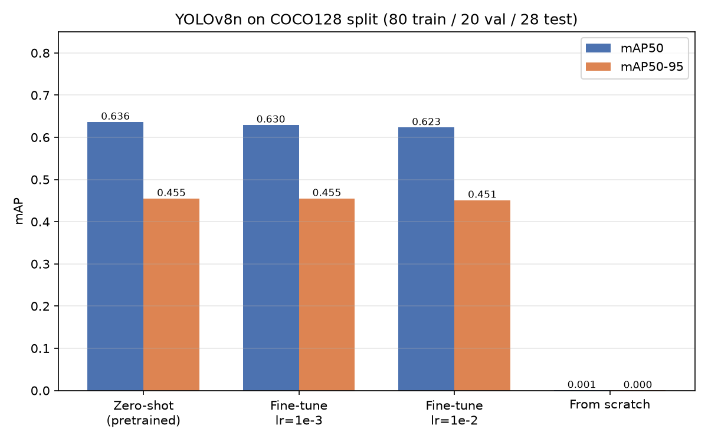
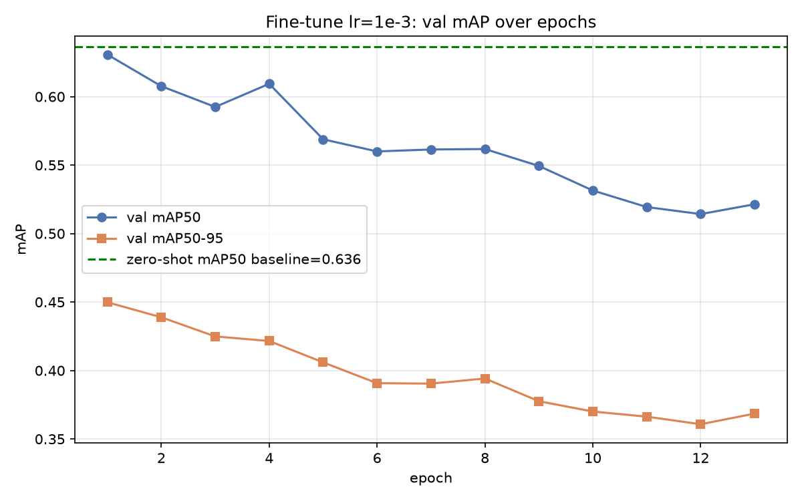

# 04 实验报告

## 结论摘要

> **预训练权重在目标检测上是决定性的**：零样本 mAP50 0.6365，微调仅得 0.6296（-0.7pp，噪声内），从头训练仅 0.0006（几乎为 0）。

在只有 80 张训练图的小数据条件下：

- 预训练特征已包含大量通用检测知识，零样本即可工作；
- 微调没有正增益，因为数据太少，预训练权重是唯一信号；
- 从头训练彻底失败，揭示检测比分类需要多几个量级的数据。

## 完整结果（28 张留出测试集，imgsz 640，batch 8）

| 实验臂 | mAP50 | mAP50-95 | Precision | Recall |
|--------|-------|----------|-----------|--------|
| 零样本（官方预训练） | **0.6365** | **0.4552** | 0.7066 | 0.5450 |
| 微调 lr=1e-3（13 epoch） | 0.6296 | 0.4554 | 0.7654 | 0.5151 |
| 微调 lr=1e-2（默认） | 0.6234 | 0.4512 | — | — |
| 从头训练（12 epoch） | 0.0006 | 0.0002 | 0.0011 | 0.0120 |

## 训练曲线

## 分项解读

### 1. 零样本基线（mAP50 0.6365）

官方 YOLOv8n 权重没看过 COCO128 一眼，却在留出测试集上拿到 mAP50 0.64。这说明 COCO 预训练让模型学会了通用的「物体在哪 + 是什么」，小数据集上的检测任务几乎不需要额外学习。

### 2. 微调（mAP50 0.6296，-0.7pp）

lr=1e-3 微调 13 个 epoch（早停触发），mAP50 从 0.6365 降到 0.6296，mAP50-95 几乎不变（0.4552→0.4554）。

> 这个差异远小于 28 张测试图的随机波动，**不能**得出「微调有害」的结论，只能说「80 张图不足以让微调产生正增益」。

注意：Precision 升到 0.7654、Recall 降到 0.5151——微调让模型更保守（少报框，但报得更准），这是小数据过拟合的典型表现。

### 3. 从头训练（mAP50 0.0006）

随机初始化在 80 张图上训练 12 个 epoch，mAP50 仅 0.0006。模型几乎没学会检测任何类别。

> 这直接把「数据规模决定论」摆上台面：分类的 CIFAR-10 有 5 万张图，从头训练能到 71%；检测的 COCO128 只有 80 张，从头训练彻底失败。

## 与第一步的对照

| | 第一步：图像分类 | 第二步：目标检测 |
|------|----------------|----------------|
| 数据集 | CIFAR-10（50k train） | COCO128（80 train） |
| 预训练 | ImageNet | COCO |
| 从头训练 | 71.48% | mAP50 0.0006 |
| 微调 | 82.04%（+10.56pp） | 0.6296（-0.7pp，噪声内） |
| 结论 | 数据够，微调有效 | 数据太少，预训练是唯一信号 |

## 核心洞见

**数据规模决定论**：

- 分类任务（10 类，5 万张）：微调稳定 +10.56pp，从头训练可用（71%）。
- 检测任务（80 类，80 张）：微调无增益，从头训练失败。

检测的输出空间是「分类 + 定位 + 多物体」，比分类复杂一个量级；在数据不足时，检测只能依赖预训练特征的迁移，无法从头学。

## 对第三步（扩散模型）的启示

扩散模型是生成任务，数据需求比检测更高。本步实验提示：**要么找够大的数据集，要么从一开始就依赖预训练/条件生成**，不要试图从零训练。

## 复现性

- 随机种子 seed=42（切分）、训练默认 seed=0（ultralytics）
- 硬件：NVIDIA RTX 5060 Laptop 8GB，CUDA 12.8
- 完整复现步骤见 `03_操作步骤.md`